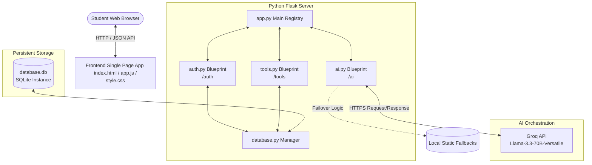

# CyberGPT – Technical & Developer Documentation

Welcome to the **CyberGPT** technical manual. This documentation is written for developers, security educators, and system architects. It covers the system's design, modular blueprints, API contracts, local fallback mechanisms, and advanced features such as the real-time password analyzer and custom HTML5 Canvas analytics.

---

## 1. System Architecture & Component Interaction

CyberGPT is built on a **lightweight, modular Python Flask** backend serving a rich, reactive **Single Page Application (SPA)** frontend built with pure HTML5, Vanilla CSS3, and Vanilla JavaScript. It leverages **SQLite** for relational tracking of student scores and integrates the **Groq API** (`Llama-3.3-70B-Versatile`) for on-demand educational query resolution and dynamic test generation.

### System Diagram



### Module File Registry

*   [app.py](file:///C:/Users/mumma/Desktop/project/app.py): Bootstraps the application context, configures cross-cutting session secrets, binds the database teardown lifecycle hook, and mounts the Modular Blueprint routes.
*   [database.py](file:///C:/Users/mumma/Desktop/project/database.py): Manages connections to the SQLite database using custom connection contexts and sets up relational tables.
*   [blueprints/auth.py](file:///C:/Users/mumma/Desktop/project/blueprints/auth.py): Implements session-based user authentication, login registration, password hashing, and active session validation.
*   [blueprints/ai.py](file:///C:/Users/mumma/Desktop/project/blueprints/ai.py): Integrates with the Groq API for AI-assisted operations and executes offline fallback failovers.
*   [blueprints/tools.py](file:///C:/Users/mumma/Desktop/project/blueprints/tools.py): Houses the backend credentials analyzer and progress grade database synchronization routines.
*   [static/js/app.js](file:///C:/Users/mumma/Desktop/project/static/js/app.js): Drives the SPA framework, maintains global runtime state, coordinates API calls, handles live triggers, and renders graphics onto the HTML5 Canvas.
*   [templates/index.html](file:///C:/Users/mumma/Desktop/project/templates/index.html): Defines the dashboard design layout, including sidebar navigations, glowing CSS themes, grid layouts, and custom view segments.

---

## 2. Database Schema & Data Models

CyberGPT uses an **SQLite 3** relational database to track student records. The database file is located in the auto-created `instance/database.db` directory. Relational operations are handled by standard connections with rows cast to dictionary formats (`sqlite3.Row`) for cleaner API serialization.

### Table: `users`
Tracks student identity profile records. Passwords are never stored in raw form; they are stored using one-way cryptographic hashes generated via `pbkdf2:sha256` inside `werkzeug.security`.

| Column | Data Type | Constraints | Description |
| :--- | :--- | :--- | :--- |
| `id` | INTEGER | PRIMARY KEY AUTOINCREMENT | Unique identifier for each student profile. |
| `email` | TEXT | UNIQUE, NOT NULL | Student's primary contact email address. |
| `password_hash` | TEXT | NOT NULL | One-way password hash. |
| `created_at` | TIMESTAMP | DEFAULT CURRENT_TIMESTAMP | Date and time when the profile was generated. |

### Table: `progress`
Maintains records of student quiz grades and learning history. Uses a composite unique constraint to enforce exactly one progress status entry per user-topic combination.

| Column | Data Type | Constraints | Description |
| :--- | :--- | :--- | :--- |
| `id` | INTEGER | PRIMARY KEY AUTOINCREMENT | Unique progress row ID. |
| `user_id` | INTEGER | NOT NULL, FOREIGN KEY | References `users(id)` with cascading updates. |
| `topic` | TEXT | NOT NULL | Name of the module (e.g. `SQL Injection`, `XSS`). |
| `quiz_score` | INTEGER | NOT NULL | Student's highest score percentage (range `0 - 100`). |
| `attempts` | INTEGER | DEFAULT 1 | Cumulative number of assessment attempts taken. |
| `last_attempt` | TIMESTAMP | DEFAULT CURRENT_TIMESTAMP | Datetime of the most recent evaluation submission. |

> [!NOTE]
> Database creation queries are executed on program startup in [database.py](file:///C:/Users/mumma/Desktop/project/database.py#L21-L56) using a `CREATE TABLE IF NOT EXISTS` statement inside Flask's application context bootstrap lifecycle.

---

## 3. Modular Blueprint API Specifications

The Flask backend is partitioned into three blueprints: **Auth**, **AI Assistant**, and **Security Tools**. Communication between the frontend client and these backend controllers is conducted through JSON payloads.

```
Request/Response Pipeline:
Client (fetch)  =======[ JSON Payload ]========>  Flask Blueprint Endpoint
Client (UI updates) <===[ JSON Response / Status ]==  Blueprint Response
```

### A. Authentication Blueprint (`/auth`)
*Prefix path: `/auth`* - Managed in [blueprints/auth.py](file:///C:/Users/mumma/Desktop/project/blueprints/auth.py)

#### 1. Registration endpoint (`/auth/register`)
*   **Method**: `POST`
*   **Request JSON Payload**:
    ```json
    {
      "email": "student@university.edu",
      "password": "SecurePassword123!"
    }
    ```
*   **Success Response (201 Created)**:
    ```json
    {
      "success": true,
      "message": "Registration successful. Please log in.",
      "user": {
        "id": 1,
        "email": "student@university.edu"
      }
    }
    ```
*   **Error Responses**:
    *   *400 Bad Request (Missing values)*: `{"success": false, "error": "Email and password are required."}`
    *   *400 Bad Request (Email exists)*: `{"success": false, "error": "An account with that email already exists."}`

#### 2. Authentication Login endpoint (`/auth/login`)
*   **Method**: `POST`
*   **Request JSON Payload**: Same as registration.
*   **Success Response (200 OK)**: Sets cookie session keys `user_id` and `email` on client browser.
    ```json
    {
      "success": true,
      "message": "Login successful.",
      "user": {
        "id": 1,
        "email": "student@university.edu"
      }
    }
    ```
*   **Error Response (401 Unauthorized)**: `{"success": false, "error": "Invalid email or password."}`

#### 3. Session Check endpoint (`/auth/session`)
Used by client SPA on page load to detect if an active, authenticated cookie session exists.
*   **Method**: `GET`
*   **Success Response (Authenticated)**:
    ```json
    {
      "authenticated": true,
      "user": {
        "id": 1,
        "email": "student@university.edu"
      }
    }
    ```
*   **Success Response (Unauthenticated)**:
    ```json
    {
      "authenticated": false
    }
    ```

#### 4. Session Termination endpoint (`/auth/logout`)
Clears user session storage objects.
*   **Method**: `POST` or `GET`
*   **Success Response (200 OK)**:
    ```json
    {
      "success": true,
      "message": "Logged out successfully."
    }
    ```

---

### B. AI Assistant Blueprint (`/ai`)
*Prefix path: `/ai`* - Managed in [blueprints/ai.py](file:///C:/Users/mumma/Desktop/project/blueprints/ai.py)

#### 1. Ask AI Assistant (`/ai/ask-ai`)
Answers queries related to cybersecurity by calling the Groq API or querying the static failover dictionary.
*   **Method**: `POST`
*   **Request JSON Payload**:
    ```json
    {
      "question": "What is SQL Injection?"
    }
    ```
*   **Success Response (200 OK)**:
    ```json
    {
      "success": true,
      "source": "groq", // Or "offline_fallback"
      "data": {
        "definition": "SQL Injection (SQLi) is a database vulnerability...",
        "example": "' OR '1'='1...",
        "impact": "Attackers can bypass authentication and read credentials...",
        "prevention": "Always use prepared statements (parameterized queries)..."
      }
    }
    ```

#### 2. Quiz Generator (`/ai/quiz`)
Generates single-question multiple-choice evaluations on demand based on specific topic prompts.
*   **Method**: `POST`
*   **Request JSON Payload**:
    ```json
    {
      "topic": "SQL Injection"
    }
    ```
*   **Success Response (200 OK)**:
    ```json
    {
      "success": true,
      "source": "groq", // Or "offline_fallback"
      "data": {
        "question": "Which of the following is the most secure method for preventing SQL injection?",
        "options": [
          "Input encoding with JavaScript",
          "Parameterized queries (prepared statements)",
          "Restricting requests to GET type",
          "MD5 password encryption"
        ],
        "correct_answer": "Parameterized queries (prepared statements)",
        "explanation": "Parameterized queries compile the SQL schema first and insert dynamic inputs as variables, preventing execution."
      }
    }
    ```

---

### C. Security Tools Blueprint (`/tools`)
*Prefix path: `/tools`* - Managed in [blueprints/tools.py](file:///C:/Users/mumma/Desktop/project/blueprints/tools.py)

#### 1. Password Strength Auditor (`/tools/password-check`)
Runs credential quality analysis algorithms on input passwords.
*   **Method**: `POST`
*   **Request JSON Payload**:
    ```json
    {
      "password": "user123!"
    }
    ```
*   **Success Response (200 OK)**:
    ```json
    {
      "success": true,
      "strength": "Moderate", // "Weak" | "Moderate" | "Strong"
      "score": 50,           // Range 0 - 100
      "suggestions": [
        "Increase password length to at least 8 characters (12+ is recommended).",
        "Add uppercase letters.",
        "Avoid repeating characters too frequently."
      ]
    }
    ```

#### 2. Load Progress Report (`/tools/progress/<int:user_id>`)
Aggregates metrics for the student's dashboard and canvas report pages.
*   **Method**: `GET`
*   **Success Response (200 OK)**:
    ```json
    {
      "success": true,
      "data": {
        "topics_completed": ["SQL Injection", "XSS"],
        "average_score": 85.0,
        "weak_areas": ["Blockchain"],
        "chart_data": [
          { "topic": "SQL Injection", "score": 100, "attempts": 1 },
          { "topic": "XSS", "score": 70, "attempts": 2 },
          { "topic": "Blockchain", "score": 40, "attempts": 1 }
        ]
      }
    }
    ```

#### 3. Update Progress Report (`/tools/progress/update`)
Saves completed quiz metrics. Keeps the user's highest score if the user retakes a quiz.
*   **Method**: `POST`
*   **Request JSON Payload**:
    ```json
    {
      "user_id": 1,
      "topic": "SQL Injection",
      "quiz_score": 100
    }
    ```
*   **Success Response (200 OK)**:
    ```json
    {
      "success": true,
      "message": "Progress updated successfully."
    }
    ```

---

## 4. AI Engine & Offline Fallback Mechanics

The application routes queries through a resilient integration layer that utilizes the **Groq Cloud API** and implements **offline fallbacks** to maintain service availability if the API is down or the user does not have a key.

```
                             [ User Request ]
                                     │
                        Is GROQ_API_KEY Configured?
                         /                       \
                       YES                        NO
                       /                            \
             [ Send API Payload ]            [ Offline Fallback ]
            /                    \                    │
        Success?                Failure?              │
         /                          \                 │
[ Return AI Response ]  -->  [ Log Error & Fallback ] ┘
                                      │
                         [ Match Keyword or Topic ]
                                      │
                         [ Return Mock Data from DB ]
```

### Groq API Configuration
Calls are directed to `https://api.groq.com/openai/v1/chat/completions` using the `llama-3.3-70b-versatile` model. Prompts are strictly structured to return JSON formatting:

*   **Prompt Architecture**: Instructs the model to output a schema without markdown wrappers or trailing comments, ensuring reliable deserialization.
*   **Parameter Settings**: Evaluated with a `temperature` setting of `0.6` to balance structured accuracy with educational explanations.

### Offline Fallback Engine
If the API connection fails (due to key expiration, timeout, or rate-limiting), the system falls back to static dictionary mapping without crashing.

#### A. Static Explanations Schema (`OFFLINE_EXPLANATIONS`)
This fallback database defines structured payloads for core topics:
*   **Supported Topics**: `sql injection`, `xss`, `csrf`, `networking`, `password security`, `blockchain`.
*   **Matching algorithm**: Checks if the target topic name matches a keyword in the user's query:
    ```python
    q_lower = question.lower()
    for key, val in OFFLINE_EXPLANATIONS.items():
        if key in q_lower or q_lower in key:
            matched_data = val
    ```
*   **Universal Fallback**: If no keywords match, the system provides a general security summary explaining threat impact and remediation steps.

#### B. Predefined Quizzes Schema (`OFFLINE_QUIZZES`)
Precompiled multiple-choice questions matching the syllabus:
*   **SQL Injection**: Focuses on prepared statements and query compilation.
*   **XSS**: Covers the persistence mechanics of Stored (Persistent) XSS.
*   **CSRF**: Illustrates session token protections and Origin checking.
*   **Networking**: Identifies secure encrypted protocol channels (SSH vs. Telnet).
*   **Password Security**: Outlines the role of salts in preventing rainbow-table precomputations.
*   **Blockchain**: Focuses on consensus-takeover mechanisms (51% attacks).

---

## 5. Password Analyzer Algorithm

The password strength checker runs scoring calculations both client-side (for real-time feedback) and server-side (for secure auditing).

### Score Calculation Rules

The auditor initializes a base score of `0` and evaluates strength across three rule categories:

#### 1. Length Rules (Max 35 points)
*   Password Length `< 8` characters: `+0` points. Suggestion generated: `Increase password length to at least 8 characters.`
*   Password Length `8 - 11` characters: `+15` points.
*   Password Length `12 - 15` characters: `+25` points.
*   Password Length `>= 16` characters: `+35` points.

#### 2. Character Diversity Rules (Max 65 points)
*   **Lowercase Check** (matches `[a-z]`): `+15` points. Missing: `Add lowercase letters.`
*   **Uppercase Check** (matches `[A-Z]`): `+15` points. Missing: `Add uppercase letters.`
*   **Digit Check** (matches `\d`): `+15` points. Missing: `Add numeric digits.`
*   **Special Character Check** (matches `[^a-zA-Z\d]`): `+20` points. Missing: `Add special characters or symbols.`

#### 3. Repetitive and Pattern Penalties (Deductions)
*   **Character Set Diversity**: If unique characters form less than half of total password length:
    *   `Score = Score - 20`
    *   Suggestion generated: `Avoid repeating characters too frequently.`
*   **Common Pattern Reductions**: If the lowered string contains common dictionary patterns (`'password'`, `'123456'`, `'qwerty'`, `'admin'`, `'welcome'`, `'letmein'`, `'cyber'`):
    *   `Score = Score - 25`
    *   Suggestion generated: `Avoid including common terms.`

### Classification Index
The score is clamped between `0` and `100`, then categorized into a visual rating tier:

```
Score:  0 ------------------ 40 --------------------- 75 ------------------- 100
Tier:         WEAK                  MODERATE                  STRONG
Color:      [ Red ]                [ Amber ]                [ Emerald ]
```

---

## 6. Frontend SPA Engine & HTML5 Canvas Charting

The client dashboard is managed as a **Single Page Application** using static assets. This eliminates page reloads and maintains user session states during API queries.

### Navigation and SPA View Logic
The SPA manages page transitions in [static/js/app.js](file:///C:/Users/mumma/Desktop/project/static/js/app.js):
*   **State Management**: Global variables track active user profile IDs, login states, current navigation views, active learning topics, and active quiz session scoring tallies.
*   **Layout Swapping**: The navigation router hides and reveals view blocks (e.g., `#view-dashboard`, `#view-ask-ai`) by toggling CSS visibility classes.
*   **Breadcrumbs**: Location strings are updated dynamically to show the active module route (e.g. `System / Take Quiz`).

### Custom Canvas Graph Drawing
Academic progress scores are rendered on a high-definition HTML5 Canvas layout:

```
Canvas Resolution Tuning:
Chart Dimension (500x300 px) -> Clear Background -> Draw Grid Lines & Percentages
                                                         │
Draw Topics X-Axis Labels <--- Plot Glowing Gradient Bars <┘
```

1.  **DPI Scaling**: The canvas scales elements dynamically to render sharp graphics on high-DPI displays.
2.  **Y-Axis Marks**: Grid lines are drawn in 25% increments from 0% to 100% to track grades.
3.  **Color Gradient Mapping**: Bars are filled with custom linear gradients:
    *   *Score >= 70%*: Fades from Emerald green (`#10b981`) to semi-transparent green. Bar border gets a bright solid Emerald accent.
    *   *Score < 70%*: Fades from Red (`#ef4444`) to semi-transparent red, highlighting topics that require review.
4.  **Neon Glow Shadows**: The canvas uses native context shadows (`shadowBlur`, `shadowColor`) to apply a glowing effect to the graph bars.

---

## 7. Deployment & Setup Manual

Follow these steps to deploy and run the CyberGPT system locally:

### 1. Verification of Workspace Structure
Verify that the project files are located as follows:
```
project/
├── app.py
├── database.py
├── requirements.txt
├── .env
├── blueprints/
│   ├── auth.py
│   ├── ai.py
│   └── tools.py
├── static/
│   ├── css/style.css
│   └── js/app.js
└── templates/
    └── index.html
```

### 2. Environment Configuration (`.env`)
Create a file named `.env` in the root folder containing the following keys:
```env
GROQ_API_KEY=gsk_ctq2HDPzz6r4QSZrEIEx...  # Add your API Key here
SECRET_KEY=cyber_security_learning_assistant_secret_key
```

### 3. Local Virtual Environment Setup

#### Windows (PowerShell)
```powershell
# Create environment
python -m venv venv

# Activate environment
.\venv\Scripts\Activate.ps1

# Install requirements
pip install -r requirements.txt
```

#### Linux / macOS
```bash
# Create environment
python3 -m venv venv

# Activate environment
source venv/bin/activate

# Install requirements
pip install -r requirements.txt
```

### 4. Running the Development Server
Run the application using:
```bash
python app.py
```
*   Upon startup, the database structure (`instance/database.db`) is automatically initialized.
*   The application runs on `http://127.0.0.1:5000`.

### 5. Diagnostics & Troubleshooting
*   **Database Locked Error**: Happens when multiple threads attempt to write to the SQLite file at the same time. Ensure that only one instance of the server is running.
*   **Missing Groq API Key**: If key values are invalid or unset, the system logs API warnings and automatically enables fallback failovers.
*   **Port 5000 Occupied**: If port 5000 is occupied, you can edit the port binding at the bottom of [app.py](file:///C:/Users/mumma/Desktop/project/app.py#L40-L42) to run on a different port (e.g. `port=5001`).
